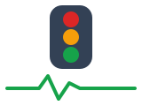

<div align="center">



# MediaDev Monitor

### by SemaOPS

*"Tu software, siempre en verde."*

[](https://www.php.net/)
[](https://laravel.com/)
[](https://filamentphp.com/)
[](https://docs.docker.com/compose/)
[](https://www.sqlite.org/)
[](https://www.un.org/sustainabledevelopment/es/economic-growth/)
[](https://www.un.org/sustainabledevelopment/es/infrastructure/)
[](LICENSE)
[](#caracter%C3%ADsticas--arquitectura)

**Software que se entiende de un vistazo.**

Monitoreo de disponibilidad, versiones, Site Health y diagnóstico de sitios WordPress, **sin instalar plugins** en los sitios monitoreados.

</div>

---

## Estado de la cartera (en vivo)

Semáforo de 4 estados sobre los 28 sitios del portafolio de MediaDev.CL:

| Estado | Sitios | Qué significa |
|:--|--:|:--|
| 🟢 `WP-FULL` | **23** | WordPress accesible por REST con Application Passwords. Monitoreo completo. |
| 🟡 `WP-DEGRADED` | **1** | WordPress detectado, pero REST o tokens no disponibles. Sólo uptime y versión básica. |
| ⚪ `NON-WP` | **2** | Sitio online que no es WordPress. Sólo uptime. |
| 🔴 `DOWN` | **2** | Sin respuesta tras 3 fallos consecutivos. Genera alerta. |

> Cifras entregadas por el equipo de SemaOPS para la demo del portafolio.

---

## Características & Arquitectura

### Zero-plugins

MediaDev Monitor no instala nada en los sitios monitoreados. Usa mecanismos nativos de WordPress:

- **Application Passwords** (WP 5.6+): un token por sitio, generado desde *Usuarios → Perfil*.
- **REST API nativa** (`/wp-json`): versiones de core, plugins, temas, Site Health y actividad reciente.
- **Detección automática**: clasifica cada sitio como WP o no-WP y degrada a monitoreo de uptime cuando REST no responde.

### Componentes

- **Monitoreo de uptime**: HTTP check cada 5 minutos, con umbral de 3 fallos consecutivos.
- **Versiones y updates pendientes**: core (rojo), plugins y temas (amarillo).
- **Site Health y actividad reciente**: métricas vía REST con Application Passwords.
- **Notificaciones**: agente de eventos (caída, recuperación, nueva versión) con resumen horario por Telegram y correo.
- **Dashboard Filament** (`/admin`): panel con semáforo unificado, widgets y gestión de sitios.
- **Página pública** (`/demo`): estado de la cartera sin login. Datos en JSON en `/status.json`.
- **CLI**: `php artisan monitor:check all`, con exit codes `0` / `1` / `2`.

### Arquitectura

```
 cron (* * * * *) → php artisan schedule:run
                          │
       ┌──────────────────┼──────────────────────┐
       ▼                  ▼                      ▼
 collector:uptime    collector:deep      monitor:check all
  (5 min)            (6 h)
       └──────────────▶ Collector (domain/)
                          │
                          ▼
 Degradation::classify(site) ──probe /wp-json──▶ RestClient ──HTTP──▶ sitios
                          │
 Uptime / Version / SiteHealth / Activity ◀──────┘
                          │
                          ▼
 Eloquent (sites, uptime_checks, version_snapshots, site_health_snapshots, activity_snapshots)
                          │
                          ├──▶ Filament panel /admin (SiteResource + widgets)
                          ├──▶ Página pública /demo y /status.json
                          └──▶ artisan CLI (reporte terminal + exit code)
```

El dominio (`laravel/domain/`) está aislado del framework: clases PHP puras con *repository ports* implementados por adaptadores Eloquent. La lógica de clasificación, severidad y 3-strike es la del framework original verificado.

### Stack

| Componente | Tecnología |
|:--|:--|
| Framework | Laravel 12 + Filament v4 (PHP 8.3) |
| Base de datos | SQLite embebido, Eloquent ORM |
| Dashboard | Panel admin Filament (login, `SiteResource`, widgets) |
| CLI | Comandos Artisan con exit codes 0/1/2 |
| Despliegue | Docker + docker compose + Laravel Scheduler |

---

## Quickstart con Docker

Requisitos: Docker con el plugin `compose`.

**1. Levantar el servicio**

```bash
docker compose up -d
```

**2. Crear el usuario administrador**

```bash
docker compose exec monitor php artisan tinker
# Dentro de tinker (la contraseña se hashea automáticamente):
# App\Models\User::create(['name' => 'Admin', 'email' => 'tu@correo.cl', 'password' => 'cambia-esta-clave']);
```

**3. Abrir el panel**

- Dashboard: <http://localhost:8080/admin>
- Página pública: <http://localhost:8080/demo>

**4. (Opcional) Emulador de portafolio**

Levanta los 28 sitios de prueba del portafolio MediaDev.CL en una red Docker aislada, sin tocar sitios reales:

```bash
docker compose --profile e2e up -d
bin/seed-portfolio.sh   # regenera config/sites.php (local, gitignored)
```

Scheduler integrado: uptime cada 5 min, recolección profunda cada 6 h, agente de notificaciones cada 5 min y resumen horario.

---

## Instalación local (sin Docker)

```bash
git clone https://github.com/Gatoco/mediadev-monitor.git
cd mediadev-monitor/laravel

# Requiere PHP 8.3 + ext-intl + ext-pdo_sqlite
composer install

cp .env.example .env          # DB_DATABASE apunta a ../data/mediadev.sqlite por defecto
php artisan key:generate
php artisan migrate

# Sitios: copiar la plantilla en la raíz del repo y completar URLs y tokens
cp ../config/sites.example.php ../config/sites.php

php artisan collector:uptime
php artisan collector:deep
php artisan serve             # http://localhost:8000/admin
```

## Uso

### CLI (Artisan)

```bash
# Monitorear todos los sitios (recolección profunda)
php artisan monitor:check all

# Uptime (cadencia corta)
php artisan collector:uptime

# Recolección profunda (versiones, salud, actividad)
php artisan collector:deep

# Listar sitios registrados
php artisan monitor:check --list

# Agente de notificaciones
php artisan notify:status                    # dispara según hallazgos
php artisan notify:status --no-channels      # imprime sin enviar (debug)
php artisan notify:status --json             # salida en JSON
php artisan notify:status --digest           # fuerza el resumen aunque no haya eventos
```

Exit codes: `0` = todo OK · `1` = hay sitios caídos o críticos · `2` = error de uso o configuración.

### Notificaciones (Telegram + Email)

El agente corre en el contenedor `monitor` vía scheduler. Compara el último uptime check con el anterior y detecta:

- **Down nuevo**: un sitio entra en estado `down`.
- **Recuperación / falso positivo**: el sitio vuelve dentro de `NOTIFY_RECOVERY_WINDOW` minutos y se notifica como recuperación.
- **Versión WP actualizada**: cambió el core entre los dos últimos snapshots.
- **Resumen horario**: checks, fallos, disponibilidad, latencia media, estados y severidades.

Canal Telegram vía HTTP API (cero dependencias) y canal email por el mailer de Laravel. Si un canal no tiene credenciales se omite sin fallar.

Configuración por entorno (`.env` del contenedor, gitignored):

```bash
TELEGRAM_BOT_TOKEN=123456:ABC-DEF...              # token del BotFather
TELEGRAM_CHAT_ID=123456789                        # chat_id destino
NOTIFY_EMAIL_TO=ops@ejemplo.cl,otro@ejemplo.cl    # vacío = canal email desactivado
NOTIFY_RECOVERY_WINDOW=15                         # minutos → falso positivo
MAIL_MAILER=log                                   # o smtp para envío real
```

Con `MAIL_MAILER=log` los correos van a `storage/logs/laravel.log`, útil en staging. Para SMTP: `MAIL_MAILER=smtp` junto con `MAIL_HOST`, `MAIL_PORT`, `MAIL_USERNAME` y `MAIL_PASSWORD`.

### Configuración de sitios

```php
<?php
// config/sites.php — gitignored, no subir a repositorio
return [
    [
        'url'   => 'https://sitio.ejemplo.cl',
        'name'  => 'Sitio de ejemplo',
        'type'  => 'auto',   // auto | wp | non-wp
        'token' => 'xxxx xxxx xxxx xxxx xxxx xxxx',  // Application Password, sólo WP
    ],
];
```

Los **Application Passwords** se generan en cada sitio WordPress: *Usuarios → Perfil → Application Passwords*. No hace falta instalar ningún plugin.

También se pueden cargar `wp_user` y `ap_token` desde el panel (*Sitios → Editar*). El campo `ap_token` se persiste sólo si se edita; dejarlo en blanco conserva el token anterior.

## Verificación E2E

```bash
docker compose --profile e2e up -d
bin/e2e-assert.sh
```

Validado de punta a punta: **12/12 checks PASS** (clasificación por fixture, 3-strike down, tokenless-first, idempotencia, exit codes), con el scheduler cron real ejecutando `collector:uptime` y `collector:deep` sobre el volumen de datos.

Suite de tests: `cd laravel && php artisan test`.

---

## Equipo & Créditos

**SemaOPS** · Software & Desarrollo Web · *Software que se entiende de un vistazo*

| Cofundador | Rol |
|:--|:--|
| **Felipe Mardones** | Cofundador |
| **Benjamín Cifuentes** | Cofundador |
| **Benjamín Contesso** | Cofundador |

SemaOPS nace en **INACAP Sede Talca**. MediaDev Monitor se desarrolla para el cliente **MediaDev.CL**, agencia de diseño web en Talca, Chile.

Web: [semaops.cl](https://semaops.cl)

---

## Innovación y Emprendimiento III

Proyecto académico de la asignatura **Innovación y Emprendimiento III (FGIE03)**, 2.º semestre 2026.

| Entregable | Código |
|:--|:--|
| Storyboard con propuesta de valor | 3.1.2.1 |
| Ficha de planificación del testeo | 3.1.2.3 |
| Matriz CDM con propuesta de valor | 3.1.2.4 |
| Matriz PESTAL profundizada | 3.1.4.1 |
| Business Model Canvas V2 (MediaDev Monitor) | Recurso 3.4 |

### Alineación con los ODS

- **ODS 8 · Trabajo Decente y Crecimiento Económico**: reduce horas improductivas en tareas mecánicas de mantención web.
- **ODS 9 · Industria, Innovación e Infraestructura**: digitaliza y da visibilidad operativa a pymes con monitoreo transparente.

---

## Roadmap

- [x] Análisis de cliente (28 sitios de MediaDev verificados)
- [x] Propuesta y especificaciones
- [x] Diseño técnico
- [x] Migración a Laravel 12 + Filament v4
- [x] Fase 1: infraestructura (SQLite, cliente REST, configuración)
- [x] Fase 2: collectors (uptime, versiones, salud, actividad)
- [x] Fase 3: interfaces (CLI Artisan, dashboard Filament)
- [x] Fase 4: Docker y verificación E2E
- [x] Fase 5: tests y documentación
- [x] Alertas por Telegram y correo
- [ ] Diagnóstico automatizado de logs con IA (en desarrollo)

## Licencia

MIT. Ver [LICENSE](LICENSE).

---

<div align="center">

**Tu software, siempre en verde.** · © 2026 SemaOPS · semaops.cl

</div>
